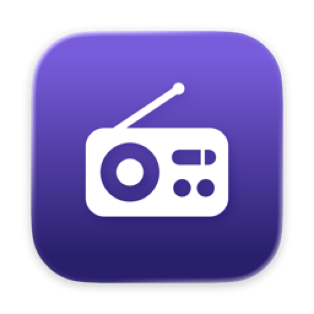
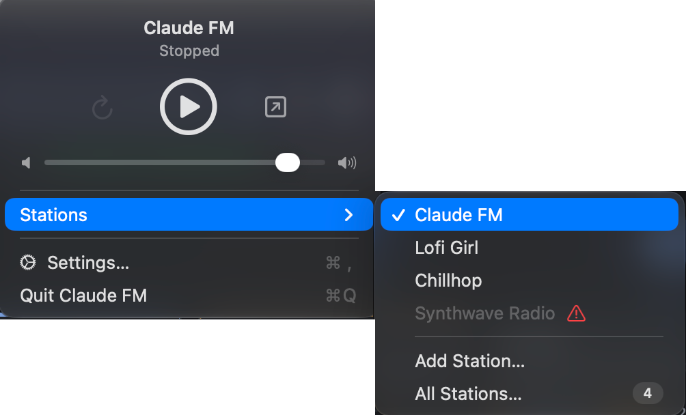
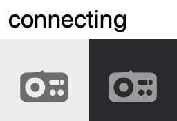
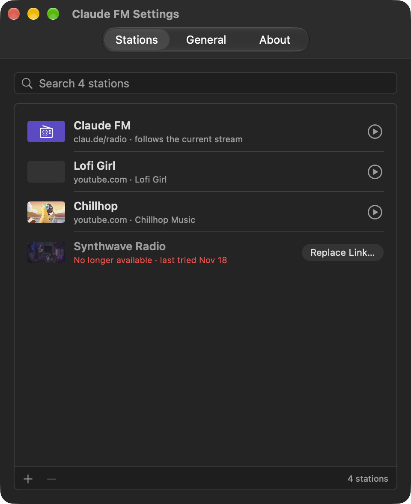
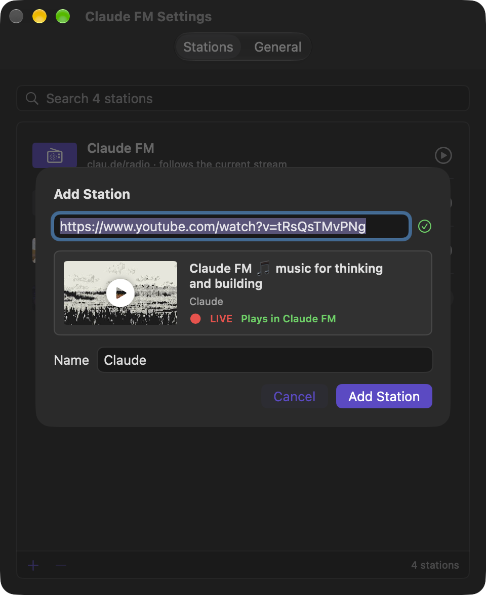

# Claude FM menu bar



A macOS menu bar app that plays [Claude FM](https://clau.de/radio), Anthropic's 24/7 lo-fi stream on YouTube.

This is a personal project, not affiliated with Anthropic. The music belongs to the stream and its artists.

- **Click** the radio icon for the menu.
- **Right-click** (or Control-click) to play or stop.



The top of the menu is the player. The big button plays and stops. While the stream is connecting it spins, and a click cancels. The arrow on the left reconnects, which looks the stream up again. The button on the right opens the video on YouTube. Under them is the volume.

**Stations** opens a submenu to switch station. With up to 10 stations it lists them all, in the order set in Settings. With more, it lists the 10 you played last, so the menu stays the same height however long the list gets. **All Stations…** opens the full list.

**Settings…** opens the app's window. Its General tab has Stop When Other Audio Plays, what a click on the icon does, Launch at Login, and updates. Its About tab has the version and a link to the source.

The menu bar icon is the radio from the app icon, and its antenna shows what the player is doing. Stopped, the radio is faded with its antenna pushed down. While connecting or buffering, the antenna swings up and down like it's hunting for a station. If the stream fails, the antenna sags and shakes every couple of seconds, and the menu says why.



To swap the clicks, set **Clicking the icon** to **Plays or stops** in the General tab. Right-click then opens the menu.

## How it plays

Claude FM is published only as a YouTube live stream. The app plays it through YouTube's embedded IFrame player, in a web view that is never shown. That keeps it to official YouTube playback with no extra dependencies.

The Claude FM stream's video ID changes when the broadcast restarts. On first play, and on **Reconnect**, the app follows `https://clau.de/radio` to find the current one. If that fails, it falls back to the ID built into `StreamPlayer.swift`.

Stopping releases the stream. Playing again reloads it, so playback starts at the live edge instead of where you stopped.

## Stations

Claude FM is put in the station list on first launch. After that it is a station like any other: you can rename it, move it, or remove it.

The Stations tab of the settings window is the list.



- **Add:** press **+**, or choose **Stations > Add Station…** in the menu. You can also drag a link from a browser onto the list or onto the menu bar icon, or paste one with the list focused.
- **Play:** press the play button on a row.
- **Rename:** double-click a row.
- **Reorder:** drag a row. Dragging is off while you search.
- **Remove:** select rows and press **−** or Delete. The list can be emptied, and **Restore Claude FM** brings the first station back.

### Adding a station

The Add Station sheet takes one YouTube link. If the clipboard already holds one, it is filled in. The app looks the link up, then loads it in a hidden player to see that it really plays. **Add Station** stays disabled until it does, so a bad link never reaches the list. The play button on the thumbnail lets you listen first. Your current station pauses while you do.



### When a link dies

A station you add points at one video. When a live stream's broadcast restarts, it gets a new video ID and the old link stops working. The Claude FM station is different: it follows `https://clau.de/radio` to the current broadcast each time it loads.

The app never checks stations in the background, so the list can be very large at no cost. It learns that a link died only when you play it. The station then turns gray in the menu and in the list, where it also shows the date. **Replace Link…** opens the sheet to give the station a new link. If the station plays again later, the mark clears on its own.

An ordinary video loops when it ends. Videos that don't allow embedded playback can't be added.

The list is kept in `~/Library/Application Support/Claude FM/stations.json`. Thumbnails are fetched as rows scroll into view and kept in `~/Library/Caches/dev.lubelski.ClaudeFM/thumbnails`.

## Stop When Other Audio Plays

When this option is on, playback stops after another app has been playing audio for about 2 seconds, so short alert sounds don't count. Apps that were already playing when you pressed play are ignored until they go quiet.

The app checks Core Audio's per-process list once a second. Its own audio comes out of a WebKit helper process, which it recognizes as its own through `responsibility_get_pid_responsible_for_pid`, a libSystem function that isn't in a public header. Some apps keep their audio output open while silent, and those can trigger it.

## Build

```sh
./scripts/bundle.sh            # builds build/Claude FM.app
./scripts/bundle.sh --install  # moves it to ~/Applications and launches it
swift test                     # the station list, its file, and link parsing
```

Requires macOS 15 and Xcode. The Command Line Tools alone don't include `actool`, which compiles the icon. For testing from a terminal, `CLAUDE_FM_AUTOPLAY=1` starts playback at launch, and state changes go to stderr. `CLAUDE_FM_OPEN` opens the settings window at launch on `stations`, `general`, `about`, or `add-station`. With `add-station`, `CLAUDE_FM_LINK` is the link to start with.

The app icon is `Resources/AppIcon.icon`, an Icon Composer file that `bundle.sh` compiles. Its artwork comes from `RadioDrawing.swift`, the same routine that draws the menu bar icon. After changing the drawing, redraw the artwork:

```sh
./scripts/render-icon.sh
```

`docs/icon.png` is a picture of the compiled icon for this README. It is not used by the build.

`docs/menu-player.png` shows the player at the top of the menu in each state. It is drawn by the app's own view code. After changing how the player looks, redraw it:

```sh
./scripts/render-menu-player.sh
```

`docs/menubar-icon.gif` and `docs/menubar-icon.png` show the menu bar icon in each player state. They are drawn by the app's own icon code. After changing how the menu bar icon looks or moves, redraw them:

```sh
./scripts/render-menubar-icon.sh
```

## Releases and updates

A release build updates itself with [Sparkle](https://sparkle-project.org). It checks the feed about once a day, downloads a newer build, verifies its signature, and relaunches into it. While the stream is playing, the relaunch waits until playback stops. **Update automatically** in the General tab turns this off.

```sh
./scripts/release.sh 1.2.0            # build, sign, notarize, and publish v1.2.0 from main
./scripts/release.sh 1.2.0 --dry-run  # build the files into build/release and publish nothing
./scripts/release.sh --check          # say whether this Mac can release now, and change nothing
```

The script publishes a GitHub Release with two files: the zipped app and `appcast.xml`, the feed. Installed copies read the feed from the latest release, so publishing the release ships the update. The one-time setup (a Developer ID certificate, notarization credentials, and a Sparkle signing key) is described at the top of the script. With an App Store Connect API key in `~/.appstoreconnect/notary.conf`, notarization works with the screen locked. The `AIMeter` notarytool profile in the Keychain works only while the screen is unlocked.

- The version is the release tag. The build number is the commit count, and Sparkle compares build numbers, so releases are built from `main`.
- A build from `bundle.sh` alone has no feed and never updates itself, so a development copy is not replaced by a release.
- The Sparkle signing key is the one AI Meter uses. Its public half is in `scripts/sparkle-public-key.txt`.

## License

MIT. See [LICENSE](LICENSE).
